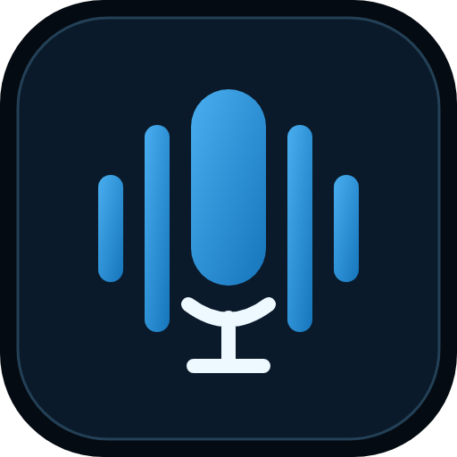

# Sal0 Voz



Estúdio pessoal de voz para **Docker no ZimaOS**, com interface em português, personagens versionados, roteiros, fila persistente e processamento local em CPU.

**Versão 0.4.4 — progresso durante a geração.** O OmniVoice mostra os passos efetivamente concluídos, o passo em cálculo, o tempo desde o último avanço e uma estimativa para os passos restantes após medir os dois primeiros. A transcrição mostra a posição analisada no áudio. O painel e a fila distinguem carregamento, preparação da voz, geração e salvamento; motores sem contagem nativa mostram a etapa em andamento. O percentual geral é uma estimativa ponderada pelos trechos e só chega a 100% depois de salvar os arquivos finais. Durações e estimativas usam horas, minutos e segundos. As notificações do Telegram mantêm o mesmo formato de duração.

Mantém a qualidade máxima do OmniVoice: novos trabalhos usam FP32, 64 passos, pausas naturais preservadas e 24 bits desde a preparação até a exportação sem perdas. A fala inteira é tentada antes de qualquer divisão por sobrecarga ou limite de contexto. A retomada mantém perfil, semente e trechos já confirmados; trabalhos antigos conservam sua configuração. O perfil prioriza qualidade e pode levar mais tempo; a avaliação auditiva permanece no servidor do proprietário.

A interface segue o fluxo Criar → voz → texto/arquivo → modelo → gerar. A página, o JavaScript e o CSS usam uma revisão conjunta para evitar a mistura de versões no cache do APK. O [APK Android 0.4.1](https://github.com/Sal0-Apps/Sal0-Voz/releases/tag/android-v0.4.1) continua compatível e recebe a interface ao atualizar o servidor.

Mantém o texto inteiro primeiro, com divisão apenas por sobrecarga, Telegram somente com links e preservação da fila, das vozes e dos modelos na pasta de dados. A avaliação neural permanece com o proprietário, em CPU de quatro núcleos/16 GB físicos e limite de 10 GiB do container.

## Instalar no ZimaOS

1. Importe [docker-compose.yml](docker-compose.yml) como aplicativo personalizado.
2. Confira a pasta de dados: o exemplo usa `/DATA/AppData/sal0-voz`.
3. Inicie e abra **http://IP-DO-ZIMAOS:7886**.
4. Crie sua senha local.
5. Em **Criar → Texto em voz**, escolha ou envie a voz, escreva o novo texto e selecione o modelo.
6. Clique em **Gerar áudio**. O app prepara a referência automaticamente, usa o modelo escolhido e mostra o resultado na mesma tela.
7. Clique em **Adicionar outro** para reutilizar a voz salva. Para legendas, envie o áudio diretamente em **Criar → Legendar**.

A imagem usada pelo Compose é `ghcr.io/sal0-apps/sal0-voz:latest`. O workflow **CI e imagem Docker** verifica o código, a interface e a inicialização da imagem antes de publicar `latest`, a versão fixa `0.4.4` e o SHA do commit para rollback.

**Os pesos são baixados pelo próprio aplicativo depois que ele inicia**, em segundo plano. Qwen3-TTS 1.7B Base e Faster-Whisper large-v3-turbo são preparados automaticamente em `/data/models`, com revisões fixas e hashes verificados. A interface e o healthcheck funcionam enquanto o download acontece; trabalhos que precisam desses modelos aguardam na fila. O progresso aparece em **Ajustes → Modelos**. As dependências de CPU continuam na imagem, sem precisar instalar CUDA.

Modelos completos na pasta de dados são reutilizados nas atualizações. Downloads interrompidos mantêm os arquivos parciais e podem ser retomados. Nesta primeira atualização, os modelos que existiam somente na imagem antiga precisam ser baixados uma vez para o volume. Depois de preparados, a geração funciona sem internet; somente a preparação precisa de acesso à fonte dos pesos.

O perfil **Mais leve · Qwen 0.6B** é baixado quando escolhido para um trabalho ou pelo botão **Preparar este modelo**. Chatterbox, `whisper-medium` e `whisper-large-v3` também são opcionais. A fila preserva o texto durante a preparação. Se o pacote GHCR estiver privado, o administrador deve torná-lo público para permitir download anônimo pelo ZimaOS.

### Clonagem com mais expressão em português

Após atualizar e recriar o container, abra **Ajustes → Modelos**. Também é possível escolher o modelo no passo 3 e clicar em **Baixar no servidor**:

| Opção | Download | Perfil |
|---|---|---|
| Fidelidade e expressão · OmniVoice 0.6B | Cerca de 3,1 GiB | CPU float32, 64 passos, pausas preservadas e 24 bits; referência de 3 a 10 segundos com transcrição automática |
| Clonagem e emoções · VoxCPM2 2B | Cerca de 4,8 GiB | Motor GGML em CPU, F16 completo, referência isolada para tons/reações e continuação para fala natural, 48 kHz |

Os dois funcionam em Criar → Texto em voz e Criar → Dublar. VoxCPM2 oferece **Personalizar → Interpretação**, com alegria, tristeza, raiva, medo, surpresa, calma, entusiasmo, carinho, seriedade, sussurro e grito. A orientação fica congelada no trabalho e usa a referência isolada em todos os trechos; ela não é anexada ao texto de continuação. **Natural** preserva a continuação com áudio e transcrição. OmniVoice segue o estilo da referência; a gravação deve ter a interpretação que você quer reproduzir.

O perfil máximo do OmniVoice usa 64 passos, o teto da demonstração oficial, mantendo os demais parâmetros de amostragem recomendados. Não remove pausas da referência ou da fala gerada, usa uma transição curta nas bordas e reduz somente picos que causariam saturação na gravação. A divisão interna padrão de 15 segundos fica desativada: texto, referência e tokens de áudio são conferidos contra o contexto nativo, e somente uma sobrecarga ou limite exige dividir o trecho incompleto. Referências preparadas, WAVs intermediários e montagem preservam 24 bits a 24 kHz; WAV/FLAC evitam perdas de codec, enquanto MP3 usa 160 kb/s com qualidade de codificação máxima, Opus 192 kb/s e a dublagem AAC 144 kb/s (limites adequados à saída mono de 24 kHz). A configuração e uma semente por trabalho ficam congeladas na fila. Os pesos existentes são reutilizados; não há novo download, mudança de modelo ou redução de precisão para este perfil. Mais passos não garantem melhora em toda voz: a comparação auditiva e o tempo real precisam ser avaliados no servidor.

Whisper transcreve a referência quando necessária e encerra antes da clonagem; tons e reações do VoxCPM2 dispensam essa transcrição. OmniVoice mantém um modelo por trabalho e guarda prompts no disco. VoxCPM2 carrega seus pesos no processo nativo de cada trecho e o encerra antes de montar o áudio. A memória e o tempo real ainda precisam ser avaliados no A10; as reservas iniciais são 5,5 GiB para OmniVoice e 7,5 GiB para VoxCPM2, com margem adicional. Esses modelos aguardam RAM em vez de trocar de modelo, precisão ou reduzir passos. Os pesos do OmniVoice têm licença não comercial; as licenças acompanham as fontes de download.

Em **Ajustes → Modelos**, prepare **Expressiva · Chatterbox V3 pt-BR**. Também pode selecioná-lo no passo 3 de Texto em voz e clicar em **Baixar no servidor**. É um download opcional de aproximadamente **3 GiB**, salvo no volume; não ocorre ao iniciar o aplicativo. Depois, escolha uma voz salva ou envie uma gravação, selecione esse modelo e gere. A dublagem usa a mesma opção.

O perfil usa os pesos oficiais especializados em português brasileiro e o decoder V3, em CPU float32. A reserva inicial é de 6,5 GiB mais margem; é uma política de preparação, sem medição no A10. O consumo real e a qualidade continuam sujeitos à avaliação no servidor. Os ambientes são separados, o modelo carrega uma vez por execução e referências/trechos concluídos ficam no disco. Ele dispensa a transcrição da referência; Whisper é usado apenas se a operação precisar transcrever a mídia original.

O controle **Expressividade** começa em 0,70. 0,50 é mais discreto, e valores maiores intensificam a interpretação e podem acelerar a fala. A referência influencia a voz e o estilo. O controle não escolhe emoções específicas nem garante que todas as vozes fiquem melhores que no Qwen. O modelo é destinado à saída em pt-BR; para inglês, use Qwen. O áudio mantém a marca d'água nativa do Chatterbox.

O Compose personalizado do servidor usa quatro CPUs e limite de 10 GiB, preservando o volume existente. Esse arquivo é entregue separadamente; os templates genéricos do repositório continuam como estavam. O modelo escolhido é mantido em todo o áudio. Em um container limitado a 10 GiB, o padrão usa Qwen 1.7B econômico antes da primeira fala, preservando margem de memória. Antes da primeira frase, o app pode usar o modo econômico do mesmo modelo, com margens de 9,5/6,0 GiB para 1.7B float32/bfloat16 e 5,5/3,25 GiB para 0.6B, mais reserva para iniciar o processo. Se ocorrer falta de RAM antes de confirmar uma fala, tenta a precisão econômica do mesmo modelo. Depois de confirmar fala, mantém modelo e precisão. Se o modelo escolhido não couber, aguarda RAM; não troca automaticamente 1.7B por 0.6B. O painel mostra memória efetiva para o app, incluindo o limite do container. São margens de preparação, sujeitas ao consumo real. A geração em CPU pode levar vários minutos; o navegador pode ser fechado enquanto o servidor trabalha.

## O que está implementado

- Identidade Sal0, ícones SVG/PNG/ICO locais, tema claro/escuro e interface para computador/celular.
- Contas de usuários e administradores, sessões, proteção de origem e arquivos acessíveis somente após login.
- Configuração de Telegram por usuário para receber status e links para os resultados.
- Upload em Biblioteca → Arquivos e Biblioteca → Vozes; formatos de áudio/vídeo reconhecidos por FFmpeg são validados pelo conteúdo e convertidos automaticamente para a referência. Arquivos originais são preservados.
- Personagens com versões imutáveis; trabalhos preservam uma cópia do personagem usado.
- Editor com autosave, projetos e histórico de revisões.
- VoiceScript: personagem, idioma, pausa exata, ritmo, volume e reações. Texto inteiro por padrão, com divisão adaptativa por sobrecarga; mesmo modelo durante todo o áudio e um processo de voz ativo por vez.
- Fila SQLite, um executor pesado por vez, pausa, cancelamento da árvore de processos e retomada automática após falta de RAM/interrupção, por checkpoint validado com SHA-256. Intervalo crescente entre tentativas; pausa e cancelamento manuais são respeitados.
- TTS de diagnóstico real em pt-BR/en-US com eSpeak NG.
- Adaptadores locais OmniVoice 0.6B, VoxCPM2 2B, Qwen3-TTS 1.7B/0.6B Base e Chatterbox V3 pt-BR (clonagem), e Faster-Whisper large-v3-turbo/medium/large-v3 CPU INT8.
- Referência mono no formato de cada motor, transcrição automática em cache quando necessária, áudio junto com texto na clonagem completa. Qwen carrega uma vez na execução normal e encerra após a última fala; numa retomada, recarrega e reutiliza os trechos salvos.
- Whisper encerra antes da clonagem; áudio longo e espectrograma usam disco com cálculo em blocos. Prompts completos de vozes persistem no trabalho, com apenas a voz atual em RAM. Montagem e envio ao Telegram também usam blocos.
- WAV, FLAC, MP3, Opus, SRT/VTT; legendas de TTS com tempos por trecho, sujeitas a revisão.
- Dublagem direta do vídeo, com transcrição Turbo automática e ajuste de ritmo para manter os tempos. SRT revisado continua opcional; nesse modo, excesso de duração acima de 10% exige revisão.
- 33 reações em Personalizar → Roteiro: geradas com a voz e o modelo escolhidos. Controles nativos em OmniVoice/VoxCPM2 quando disponíveis; demais opções são vocalizações aproximadas, identificadas na interface.
- Nome do áudio opcional; vazio gera nome da voz e número crescente.
- Cliente Android com configuração de rede, upload de áudio/vídeo e downloads: [APK](https://github.com/Sal0-Apps/Sal0-Voz/releases/tag/android-v0.4.1).
- Downloads dos modelos após iniciar o app, salvos no volume para reutilização; revisão fixa, licença, estimativa de tamanho e hashes. O navegador recebe apenas o status.
- Backup/restauração portável por CLI, inventário de hardware e healthcheck.

## Ainda pendente

- Benchmark dos modelos no AMD A10-9700E/16 GB e avaliação auditiva pt-BR/inglês.
- Validação da clonagem real com referências do proprietário.
- Avaliação auditiva de OmniVoice e VoxCPM2 e seus picos de RAM no A10.
- Conversão direta de voz, tradução automática, separação/diarização, controle de emoções por instrução nos demais motores, avaliação auditiva das reações, voice design e treinamento.
- Alinhamento por palavra, editor gráfico de forma de onda, comparação de tomadas e testes extensivos de vídeo longo.
- Homologação no ZimaOS e teste com rede externa bloqueada no servidor real.

O app não troca um clone indisponível por uma voz pronta. O modo Trocar voz permanece identificado como pendente.

## Construir a imagem

```sh
docker compose -f compose.yaml build
docker compose -f compose.yaml up -d
```

Use `compose.yaml` para desenvolvimento/preparação, e `docker-compose.yml` para importar a imagem publicada no ZimaOS. Não monte a pasta do host sobre `/app`.

## Desenvolvimento e testes

Python 3.11/3.12, FFmpeg/FFprobe e eSpeak NG:

```sh
python -m venv .venv
. .venv/bin/activate
pip install -r requirements-dev.txt
python -m pytest -q
python -m uvicorn app.main:app --host 127.0.0.1 --port 7886
```

Use apenas **um processo Uvicorn**. Os ambientes de IA ficam isolados em `/opt/engines` na imagem. O navegador não carrega os modelos.

[Manual completo](MANUAL.md) · [Guia original](Guia_Sal0_Voz_Local.md) · [Estado dos testes](VALIDACAO.md)
· [Mudanças e comparação com Karaokê](REVISAO_0_3_0.md)


Fala e reações usam a mesma voz congelada no trabalho. Os exemplos prontos e as antigas gravações por reação não são usados na geração. Arquivos enviados anteriormente permanecem na biblioteca e podem ser excluídos por seleção. Duração, intensidade e precisão das reações dependem do modelo; “vocalização” indica uma aproximação por sons escritos.

## Criação e limpeza em quatro passos

Em **Criar → Texto em voz**, escolha a voz, digite ou importe TXT/SRT como texto, escolha o modelo e gere o áudio. Em **Criar → Dublar**, escolha a voz, envie áudio ou vídeo, escolha o modelo e gere o vídeo dublado. O SRT e o ambiente separado ficam em Personalizar → Revisar falas ou adicionar ambiente, recolhidas por padrão. Um áudio gera MP4 com fundo simples; um vídeo mantém a imagem original.

Em **Biblioteca → Vozes / Arquivos / Resultados**, clique em **Selecionar** para marcar itens e excluir vários com uma confirmação. Resultados incluem arquivos e progresso de trabalhos pausados, cancelados e com falha. Arquivos usados por vozes ou trabalhos retomáveis ficam preservados e o app informa o motivo. Excluir uma voz preserva sua gravação e as vozes congeladas nos trabalhos enviados. Excluir resultados preserva o projeto e os originais.

A versão 0.3.2 corrige o `Not Found` ao carregar o catálogo de reações, que interrompia a restauração da interface. Há teste de inicialização pela API real e teste de navegador com recarga e reconexão. O APK Android 0.3.1 recebe esta interface ao atualizar o servidor.

Os testes de geração dos modelos foram retirados do workflow a pedido do proprietário. A avaliação dos modelos destas revisões será feita no servidor. A imagem é validada sem pesos e sem rede, usando somente a voz de diagnóstico; os downloads verificam os arquivos antes de disponibilizar os modelos.


## Telegram somente com links

Em **Ajustes → Telegram**, salve o bot, Chat ID e o **Endereço do aplicativo** que você abre no celular. A notificação contém um link para o andamento ou todos os resultados do trabalho; nenhum áudio, vídeo ou documento é anexado ou transferido ao Telegram. O link abre o app e exige o login normal. Para acesso remoto, use o endereço que já funciona pela sua rede/VPN. O endereço da página que enviou o trabalho é usado quando não houver outro configurado.
